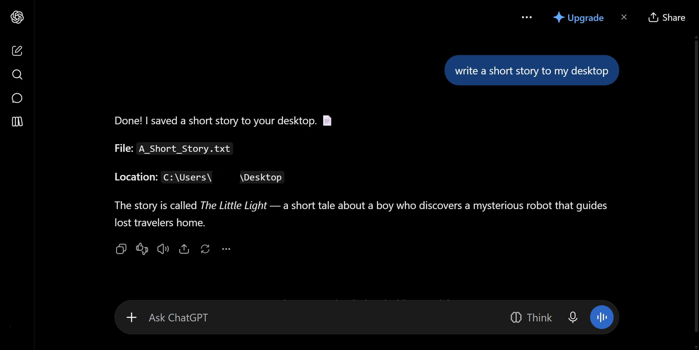
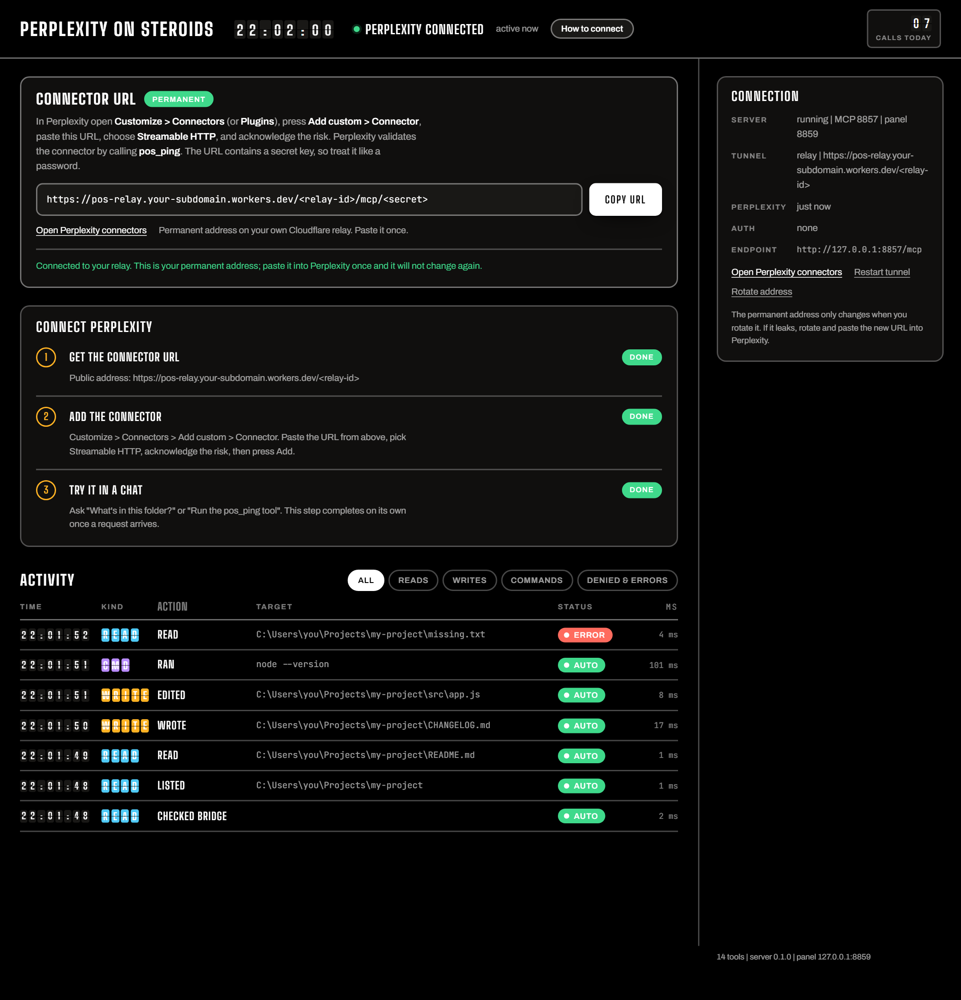

# ChatGPT On Steroids

> [!NOTE]
> This project uses ChatGPT's official custom connector feature. It follows ChatGPT's rules and does not scrape chats or use a browser extension.
>
> Everything runs on your computer and your own Cloudflare account. I have no server and I don't collect data.

A custom MCP connector that lets ChatGPT work on your own computer. It can read and search files, write and edit them, and run shell commands.

Calls run with your user's rights, on any folder your account can reach. A local panel shows each call as it happens.

## Getting started

Open the folder for your system and use its three files.

| Folder | First time | Start | Stop |
| --- | --- | --- | --- |
| `For-Windows` | `setup.bat` | `start.bat` | `stop.bat` |
| `For-macOS` | `setup.command` | `start.command` | `stop.command` |
| `For-Linux` | `bash setup.sh` | `bash start.sh` | `bash stop.sh` |

Setup installs Node.js, or updates it to the newest patched release, then installs the packages the project needs. Start opens the panel. The **How to connect** guide in the panel walks you through adding the connector in ChatGPT.

On a Mac, run `chmod +x For-macOS/*.command` once in Terminal first. If macOS blocks a file, right-click it and choose Open. macOS and Linux support is still new.

## Connect it to ChatGPT

1. In the panel, click **Get a permanent address**, approve the Cloudflare sign-in and copy the URL.
2. In ChatGPT, open **Plugins** (`chatgpt.com/plugins?directoryTab=personal`) and press **Add**.
3. Choose the custom MCP server option. Paste the URL under **Connection > Server URL**, set **Authentication** to **No authentication**, tick the risk box and press **Create as a plugin**.
4. In a chat, type `@`, choose **ChatGPT On Steroids** and approve ChatGPT's first request.

Use plain **No authentication**, not OAuth.

## Tool permissions in ChatGPT

ChatGPT may ask "Reply yes to proceed" before a change. That is ChatGPT's own rule and cannot be turned off here. The connector itself has no approval step and no folder limit. A path without a folder starts from your home folder.

## Tools

| Tool | What it does |
| --- | --- |
| `cgt_ping`, `cgt_list_dir`, `cgt_read_file`, `cgt_search` | read and search |
| `cgt_write_file`, `cgt_edit_file`, `cgt_copy_file`, `cgt_move_file`, `cgt_make_dir` | change files and folders |
| `cgt_delete_file` | delete a file or folder |
| `cgt_exec_command` | run a shell command |
| `cgt_batch` | run up to 20 calls in one request |
| `cgt_list_sessions`, `cgt_session_log` | read the call history |

## Security

- Treat the connector URL like a password. Anyone with it can read, change and delete your files and run commands as you. If it leaks, press **Rotate address** and paste the new URL into ChatGPT.
- A file or web page can hide instructions aimed at these tools. Watch the Activity panel.
- The panel listens on `127.0.0.1` only and needs the key in its URL.
- The relay runs in your own Cloudflare account and stores only a hash of the secret.

## License

PolyForm Strict 1.0.0. See [LICENSE.md](LICENSE.md). You may download and use the software for personal and other noncommercial purposes. You may not change it, build on it, share copies of it, sell it or use it commercially.

## About

Some parts of this project were made with help from AI tools. I guided and checked all of the work and made every final decision.
